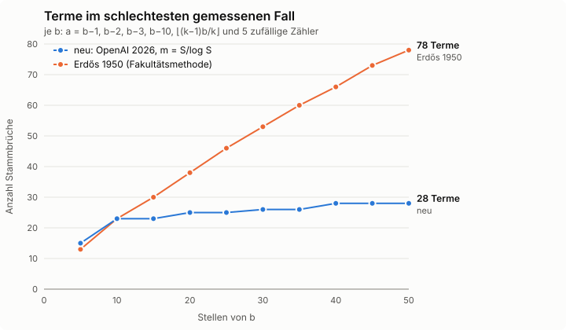

# Wie viele Stammbrüche braucht man?
## Ein 76 Jahre altes Rätsel – gelöst von einer KI

**Name:** ______________________ **Datum:** ____________

*Hilfsmittel: Taschenrechner. Teile A–D: ca. 45 Minuten, Teil E: weitere 30–45 Minuten.*

## Teil A – Rechnen wie im alten Ägypten

> **Info:** Im alten Ägypten wurden Brüche (fast) nur als Summen von **Stammbrüchen**
> geschrieben, also Brüchen mit Zähler 1 wie 1/2, 1/3, 1/4, … Jeder Stammbruch durfte dabei
> **nur einmal** vorkommen. Der *Papyrus Rhind* (um 1550 v. Chr.) enthält eine Tabelle
> solcher Zerlegungen, zum Beispiel
>
> 2/5 = 1/3 + 1/15  und  2/7 = 1/4 + 1/28.
>
> Statt „2/5 = 1/5 + 1/5“ (doppelt, nicht erlaubt!) schreibt man also 1/3 + 1/15.

**A1** Prüfe die beiden Zerlegungen aus dem Papyrus durch Rechnen mit Brüchen.

**A2** Zerlege in verschiedene Stammbrüche:

3/4 = ……………………………………………………

5/6 = ……………………………………………………

7/12 = ……………………………………………………

## Teil B – Ein Rezept: die „gierige“ Methode

Leonardo von Pisa (genannt *Fibonacci*) beschrieb im Jahr 1202 ein Verfahren, das **immer**
funktioniert:

> **Rezept**
>
> 1. Suche den **größten** Stammbruch 1/n, der noch in den Bruch hineinpasst.
>    (Tipp: Bilde den Kehrwert des Bruchs und **runde auf**. Für 4/5 ist der Kehrwert 1,25 → n = 2.)
> 2. Ziehe 1/n ab.
> 3. Wiederhole mit dem Rest, bis nichts mehr übrig ist.
>
> **Beispiel:** 4/5 − 1/2 = 3/10;  3/10 − 1/4 = 1/20.  Also **4/5 = 1/2 + 1/4 + 1/20**.

**B1** Zerlege 3/7 mit dem Rezept.

**B2** Zerlege 10/11 mit dem Rezept. Wie viele Stammbrüche brauchst du?

**B3** *Überraschung:* Für 5/121 liefert das Rezept

5/121 = 1/25 + 1/757 + 1/763309 + 1/873960180913 + 1/1527612795642093418846225.

Es geht aber auch kürzer: **5/121 = 1/25 + 1/759 + 1/208725.**
Prüfe die kurze Zerlegung mit dem Taschenrechner: Berechne 5 : 121 und die Summe der drei
Stammbrüche als Dezimalzahlen und vergleiche.
Was lernst du daraus über das Rezept?

______________________________________________________________________

______________________________________________________________________

## Teil C – Die Forscherfrage

Jeder Bruch zwischen 0 und 1 lässt sich in verschiedene Stammbrüche zerlegen. Aber:

> **Wie viele Stammbrüche braucht man höchstens, wenn der Nenner b ist?**

Ein Computer kann für kleine Nenner **alle** Möglichkeiten durchprobieren. Die Tabelle zeigt,
bei welchem Nenner man zum ersten Mal eine bestimmte Anzahl von Stammbrüchen braucht:

| benötigte Stammbrüche | 1 | 2 | 3 | 4 | 5 | 6 | 7 | 8 |
|---|---|---|---|---|---|---|---|---|
| erster Nenner b | 2 | 3 | 5 | 11 | 17 | 79 | 733 | 27 539 |
| Beispielbruch | 1/2 | 2/3 | 4/5 | 8/11 | 16/17 | 77/79 | 732/733 | 27538/27539 |

*Zum Beispiel ist 77/79 = 1/2 + 1/3 + 1/8 + 1/62 + 1/4743 + 1/96696, und kürzer geht es nicht.*

**C1** Betrachte die Beispielbrüche. Was fällt dir auf? Welche Brüche sind offenbar „schwer“?

______________________________________________________________________

**C2** Wie viele Stellen haben die Nenner in der Tabelle? Wie entwickelt sich die Stellenzahl
von Rekord zu Rekord?

______________________________________________________________________

> **Info: Die log-Taste als „genaue Stellenzahl“**
> Die Taste **log** auf dem Taschenrechner gibt an, wie oft man 10 mit sich selbst
> multiplizieren muss, um eine Zahl zu erhalten: log(10) = 1, log(1000) = 3, log(500) ≈ 2,7.
> Für ganze Zahlen gilt grob: **log(b) ≈ Stellenzahl von b minus 1.**
> Dann ist **log(log(b))** so etwas wie die **„Stellenzahl der Stellenzahl“** von b.

**C3** Fülle die Tabelle mit dem Taschenrechner aus (auf zwei Nachkommastellen runden).

| Stammbrüche | 4 | 5 | 6 | 7 | 8 |
|---|---|---|---|---|---|
| Nenner b | 11 | 17 | 79 | 733 | 27 539 |
| log(b) („Stellenzahl“) | | | | | |
| log(log(b)) („Stellenzahl der Stellenzahl“) | | | | | |

Um wie viel wächst log(log(b)) ungefähr pro zusätzlichem Stammbruch (ab 5 Stammbrüchen)?

______________________________________________________________________

**C4** *Schätzen wie ein Forscher:* Nimm an, das Muster aus C3 geht so weiter.
Ein Nenner mit **100 Stellen** hat log(log(b)) ≈ 2. Wie viele Stammbrüche würde man dann
ungefähr brauchen? *(Das ist eine Schätzung – noch kein Beweis!)*

______________________________________________________________________

## Teil D – Das Rätsel von Paul Erdős

> **Info:** Der ungarische Mathematiker **Paul Erdős** (1913–1996) schrieb über 1500
> Forschungsarbeiten und hinterließ Hunderte offene Probleme. **1950** stellte er die
> Vermutung auf:
>
> *Man braucht nie mehr als ein festes Vielfaches der „Stellenzahl der Stellenzahl“ des
> Nenners.* (In Formeln: höchstens c · log(log(b)) Stammbrüche, für eine feste Zahl c.)
>
> Er bewies auch, dass es **nicht besser** geht: Brüche wie (b−1)/b brauchen tatsächlich
> so viele. Beweisen konnte er nur eine viel schwächere obere Grenze.
>
> | Jahr | Wer | Höchstens so viele Stammbrüche nötig (S = Stellenzahl von b, ohne feste Faktoren) |
> |---|---|---|
> | 1950 | Paul Erdős | S / log(S) |
> | 1985 | Michael Vose | √S |
> | **2026** | **ein KI-Modell von OpenAI** | **log(S)** – Erdős' Vermutung ist bewiesen! |
>
> Am 25. September 2026 veröffentlichte OpenAI den Beweis *„Short Egyptian fractions“*,
> erzeugt von einem internen KI-Modell. Das Problem steht in der Liste der Erdős-Probleme
> als **Problem Nr. 304** und war **76 Jahre** lang ungelöst.

**D1** Berechne die drei Grenzen aus der Tabelle (ohne feste Faktoren):

| Nenner b | Stellenzahl S | Erdős 1950: S / log(S) | Vose 1985: √S | KI 2026: log(S) |
|---|---|---|---|---|
| 100 Stellen | 100 | | | |
| Googol (1 mit 100 Nullen) | 101 | | | |
| Googolplex (1 mit Googol Nullen) | ≈ 10¹⁰⁰ | | | |

Was fällt dir auf?

______________________________________________________________________

**D2** Ein Computerprogramm hat das Verfahren aus dem neuen Beweis und das Verfahren von Erdős
(1950) an Nennern mit bis zu 55 Stellen getestet. Das Diagramm zeigt, wie viele Stammbrüche im
schlechtesten getesteten Fall entstanden:

Beschreibe das Diagramm in zwei Sätzen. Welches Verfahren wird bei einem Nenner mit
1000 Stellen vermutlich weniger Stammbrüche brauchen? Begründe.

______________________________________________________________________

## Teil E – Kritisch nachgedacht *(Erweiterung)*

> **Info: Wie ist das Ergebnis entstanden?**
>
> * OpenAI hat einem unveröffentlichten KI-Modell rund **4000 offene Probleme** gestellt.
>   Pro Ergebnis rechnete das Modell im Schnitt etwa **drei Stunden**.
> * Veröffentlicht wurden über **700 Manuskripte**. Nur bei **etwa 42 %** der Hauptergebnisse
>   gibt es bisher einen Computer-geprüften Beweis. OpenAI schreibt selbst, dass
>   nicht geprüfte Ergebnisse Fehler enthalten könnten.
> * Der Beweis zu den Stammbrüchen **ist** vollständig mit dem Programm **Lean** geprüft.
>   Lean ist ein *Beweisassistent*: Ein Computerprogramm kontrolliert jeden einzelnen
>   logischen Schritt. Menschen müssen dann „nur noch“ prüfen, ob die *Aussage* richtig
>   formuliert ist.
> * Der Beweis zeigt, dass es eine feste Zahl c gibt – er sagt aber nicht, wie groß sie
>   ist. Die Zahlen im Beweis sind riesig (zum Beispiel 100, 1000, 100 000) und wirken erst
>   bei unvorstellbar großen Nennern.

**E1** Ein Computer hat in Teil C alle Nenner bis 27 539 durchprobiert. Warum ist das
trotzdem **kein** Beweis für Erdős' Vermutung?

______________________________________________________________________

**E2** Der Beweis ist mit Lean geprüft. Reicht das, um ihm zu vertrauen? Was könnte trotzdem
schiefgehen?

______________________________________________________________________

**E3** Für einen Nenner mit 50 Stellen lieferte das Verfahren aus dem neuen Beweis bis zu 28
Stammbrüche. Nach deiner Schätzung aus C4 geht es vermutlich mit deutlich weniger (etwa 14).
Widerspricht das dem Beweis? Was ist der
Unterschied zwischen „beweisen, dass es geht“ und „die beste Lösung finden“?

______________________________________________________________________

**E4** *Diskussion in der Gruppe:*

* Wer ist der „Entdecker“ – die KI, die Firma, oder die Menschen, deren Ideen die KI gelernt hat?
* Wenn KIs in kurzer Zeit Hunderte Beweise schreiben: Wer soll sie alle prüfen und verstehen?
* Was bedeutet das für Mathematik in der Schule und für den Beruf Mathematikerin/Mathematiker?

Notiert eure wichtigsten Argumente:

______________________________________________________________________

______________________________________________________________________
